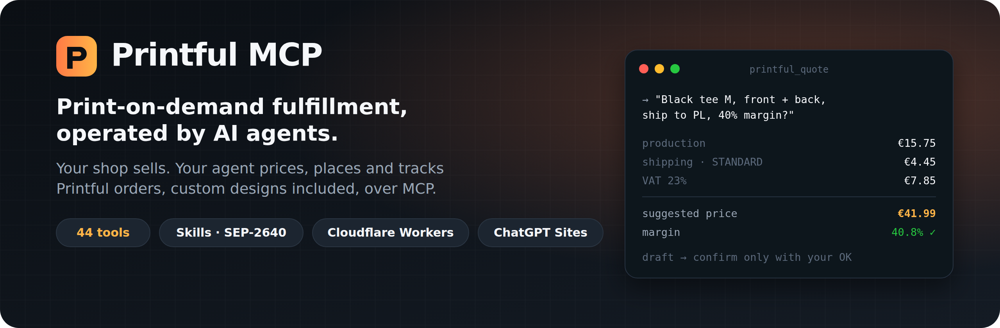
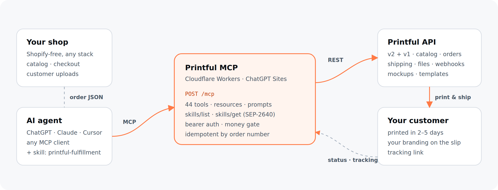

<div align="center">



<h3>The Model Context Protocol server for Printful</h3>

<p>
Let ChatGPT, Claude, Cursor or any MCP client run print-on-demand for <b>your own shop</b>:<br>
price products, quote shipping, place orders with customers' custom designs, and track every parcel.
</p>

<p>
<a href="https://github.com/michaljerzylew/printful-mcp/releases/latest"></a>
<a href="https://www.npmjs.com/package/@michaljerzylew/printful-mcp"></a>
<a href="https://github.com/michaljerzylew/printful-mcp/actions/workflows/ci.yml"></a>
<a href="LICENSE"></a>


</p>

<p>
<a href="#-quick-start">Quick start</a> ·
<a href="#-what-your-agent-can-do">Capabilities</a> ·
<a href="#-tools">Tools</a> ·
<a href="#-the-skill">Skill</a> ·
<a href="docs/deploy-chatgpt-sites.md">ChatGPT Sites</a> ·
<a href="docs/clients.md">Claude / Cursor</a> ·
<a href="docs/security.md">Security</a>
</p>

</div>

---

## Why

Printful's built-in integrations assume Shopify, Etsy or WooCommerce. If you sell from **your own storefront** (custom site, headless checkout, marketplace, Instagram DMs), every order has to be pushed to Printful by hand or with glue code.

**Printful MCP removes the glue.** It turns the full Printful API into 44 well-described tools plus an operating skill, so an AI agent can:

- answer *"what does this cost to make and ship, and what should I charge?"* with real Printful numbers;
- turn a shop order, including a customer's uploaded photo, logo or embroidery note, into a correct Printful order;
- hold it as a draft, show you the exact charge, and submit it **only after you say yes**;
- follow up on production, shipments and tracking links.

> [!NOTE]
> Independent open-source project built on the public [Printful API](https://developers.printful.com/docs/). Not affiliated with or endorsed by Printful. "Printful" is a trademark of its owner.

<div align="center"></div>

## ✨ What your agent can do

| Capability | What it means for you |
|---|---|
| 🧮 **Price anything** | Production cost per technique and placement (first placement included, labels and options extra), live shipping rates, the **exact** order charge with VAT, and a retail price for a target margin after VAT, payment fees and `.99` rounding. |
| 🎨 **Custom designs** | Each order line can carry the customer's own artwork, position in inches, embroidery notes and inside labels. SKU patterns like `TEE-CUSTOM-BLK-{size}` map to the right variant automatically. |
| 📦 **Order safely** | Idempotent by your order number (resending never duplicates). Drafts by default. Confirmation requires explicit consent **and** a `max_cost` ceiling enforced server-side. |
| 🚚 **Ship & track** | Shipments, carriers, tracking URLs, invoices, approval sheets for embroidery, branded packing slips and gift notes. |
| 🗂️ **Run the store** | File library, store (sync) products, product templates, webhooks (all v2 events), mockup generator, warehouse, US sales tax, statistics. |
| 🧠 **Knows the job** | The bundled skill `printful-fulfillment` teaches the workflow, the money rules and the data formats. It is served natively via the MCP Skills extension (SEP-2640), with fallbacks for every client. |

## 🚀 Quick start

### Option 0: local, one line (Claude Desktop, Cursor, Claude Code, any stdio client)

No server, no deploy. Add this to your MCP config:

```json
{
  "mcpServers": {
    "printful": {
      "command": "npx",
      "args": ["-y", "@michaljerzylew/printful-mcp"],
      "env": { "PRINTFUL_API_TOKEN": "<your token>", "PRINTFUL_STORE_ID": "<your store id>" }
    }
  }
}
```

Claude Code: `claude mcp add printful -e PRINTFUL_API_TOKEN=… -e PRINTFUL_STORE_ID=… -- npx -y @michaljerzylew/printful-mcp`

> [!TIP]
> Until the package is on the npm registry, point `npx` at the release tarball instead. It works the same way:
> `"args": ["-y", "--package=https://github.com/michaljerzylew/printful-mcp/releases/download/v1.2.0/printful-mcp-cli-1.2.0.tgz", "printful-mcp"]`

The npm package is a single self-contained file (~33 kB, zero dependencies, Node ≥ 18). It has the same 44 tools, skill and money gate as the hosted server.

### Option A: ChatGPT Sites (no infrastructure, per-user OAuth)

1. Download the [latest release](https://github.com/michaljerzylew/printful-mcp/releases/latest) zip.
2. In ChatGPT **Work** (or the Codex app), attach it and say:
   `@Sites publish this existing project as a site without changing the code.`
3. In the Site settings add `CONNECTOR_ENCRYPTION_KEY` (`openssl rand -base64 32`) and `PUBLIC_ORIGIN` (your site URL), then publish again.
4. In ChatGPT connect **`https://<your-site>/api/printful/mcp`** with **OAuth**. A connection screen asks for your Printful token, checks it with Printful and stores it encrypted. ChatGPT never sees the token.

Full walkthrough: **[docs/deploy-chatgpt-sites.md](docs/deploy-chatgpt-sites.md)**.

### Option B: Cloudflare Workers (your account)

```bash
git clone https://github.com/michaljerzylew/printful-mcp && cd printful-mcp
npm ci && npm run build
npx wrangler secret put PRINTFUL_API_TOKEN --config dist/server/wrangler.json
npx wrangler secret put MCP_API_KEY        --config dist/server/wrangler.json
npx wrangler deploy --config dist/server/wrangler.json --var PRINTFUL_STORE_ID:<your-store-id>
```

### Option C: run locally

```bash
npm ci
cp .env.example .dev.vars    # fill in PRINTFUL_API_TOKEN, PRINTFUL_STORE_ID, MCP_API_KEY
npm run build && cp .dev.vars dist/server/
npm start                    # http://localhost:8787/mcp
```

### Connect a client

```jsonc
// Claude Desktop / Cursor / any client with remote MCP + headers
{
  "mcpServers": {
    "printful": {
      "url": "https://<your-host>/mcp",
      "headers": { "Authorization": "Bearer <MCP_API_KEY>" }
    }
  }
}
```

More clients (Claude Code, ChatGPT developer mode, `mcp-remote` for stdio-only apps): **[docs/clients.md](docs/clients.md)**.

### Get a Printful token and store

1. [developers.printful.com/tokens](https://developers.printful.com/tokens) → **Create private token** with all scopes you want the agent to use (orders, stores, products, files, webhooks, templates).
2. Printful Dashboard → **Stores → Add store → Manual order platform / API**. Its numeric id is your `PRINTFUL_STORE_ID` (or ask the agent: *"call printful_stores_list"*).

## 💬 Try these prompts

```text
What does a black Bella+Canvas 3001 in M with a front and back print cost to make and ship to Germany?
At a 40% margin incl. 19% VAT and 2.9% + €0.25 Stripe fees, what should I charge?

Here is order #1042 from my shop (JSON). The customer uploaded https://…/dog.png for the front.
Dry-run it, show me the exact Printful charge, and wait for my OK.

Which of my Printful orders from this week are on hold, and why?

Make a mockup of design https://…/logo.png on the unisex hoodie (product 146), black and navy.

Set up webhooks to https://shop.example.com/printful for shipments and failed orders.
```

## 🧰 Tools

<details open>
<summary><b>Pricing &amp; quoting</b></summary>

| Tool | What it does |
|---|---|
| `printful_calc_cost` | Production cost of a variant: technique base + placements + options, with discount tiers. No store needed. |
| `printful_shipping_rates` | Shipping methods, rates and delivery days to a destination. |
| `printful_estimate_order` | Exact Printful charge (subtotal, shipping, VAT/tax, total) for a raw order, a shop order or quick items. |
| `printful_calc_retail` | Shop price from cost: markup or target margin, VAT, payment fees, rounding, free-shipping fold-in. |
| `printful_quote` | One call: cost + cheapest shipping + suggested retail price. |

</details>

<details open>
<summary><b>Orders &amp; fulfillment</b></summary>

| Tool | What it does |
|---|---|
| `printful_fulfill_shop_order` | Shop order (+ SKU mapping) → Printful order. `dry_run`, idempotent, `confirm` gated by `max_cost`. |
| `printful_orders_list` · `printful_get_order` | Browse and inspect orders (`@your-order-number` works as id). |
| `printful_create_order` · `printful_update_order` | Raw v2 draft create / RFC 7386 patch. |
| `printful_confirm_order` | Submit for production (charges your balance; requires `max_cost`). |
| `printful_cancel_order` · `printful_delete_order` | Cancel before production / delete uncharged drafts. |
| `printful_order_items` | List, add, update, delete items of a draft. |
| `printful_order_shipments` · `printful_order_invoice` | Tracking numbers and URLs, invoices. |
| `printful_approval_sheets` | Approve or request changes for held designs (e.g. embroidery). |

</details>

<details>
<summary><b>Catalog</b></summary>

`printful_catalog_search` · `printful_catalog_product` · `printful_catalog_variants` · `printful_catalog_categories` · `printful_catalog_prices` · `printful_catalog_sizes` · `printful_catalog_availability` · `printful_catalog_images` · `printful_catalog_shipping_countries` · `printful_catalog_mockup_templates` · `printful_catalog_mockup_styles` · `printful_catalog_printfiles` · `printful_countries`

</details>

<details>
<summary><b>Store, files, products, templates, webhooks, mockups</b></summary>

`printful_whoami` · `printful_stores_list` · `printful_store_get` · `printful_store_statistics` · `printful_store_packing_slip` · `printful_files` · `printful_store_products` · `printful_product_templates` · `printful_webhooks` · `printful_mockups` · `printful_warehouse` · `printful_tax` · `printful_api` (escape hatch) · `printful_skill`

</details>

Every tool ships MCP annotations (`readOnlyHint`, `destructiveHint`, `openWorldHint`) so clients can auto-approve reads and ask before writes. Full reference with parameters: **[docs/tools.md](docs/tools.md)**.

## 🧠 The skill

`skills/printful-fulfillment/` is an [Agent Skill](https://agentskills.io/specification) compiled into the server at build time:

| File | Contents |
|---|---|
| `SKILL.md` | Ground rules (money gate, idempotency, public file URLs, store scope), the pricing and fulfillment workflows, branding, troubleshooting. |
| `references/pricing.md` | How Printful prices are built, worked examples, the retail and margin formulas, EU VAT reminders. |
| `references/order-format.md` | The canonical shop-order JSON and the resulting Printful v2 item. |
| `references/mapping.md` | SKU → Printful mapping with patterns, placeholders and optional fields. |

It reaches the model through every channel a client may support:

1. **MCP Skills extension (SEP-2640)**: `io.modelcontextprotocol/skills` capability, `skills/list`, `skills/get`, `resources/read`, `resources/directory/read`, `skill://printful-fulfillment/...` URIs with SHA-256 digests and byte sizes.
2. **MCP resources**: the same files in `resources/list`.
3. **Tool**: `printful_skill` returns any skill file on demand.
4. **Server instructions** carry the essential rules.
5. **Upload**: `printful-fulfillment-skill.zip` in every release, for apps that import skills.

## 🔐 Security model

- **Two auth modes.**
  - **`/api/printful/mcp`: OAuth 2.1** (DCR, PKCE S256, signed request-bound consent form). Each user's Printful token is validated with Printful, encrypted with AES-GCM per grant in D1, and never returned to the client. Refresh tokens rotate atomically and can be revoked. A server-wide token is never used here.
  - **`/mcp`: API key**, described next.
- **API key (`/mcp`):** `Authorization: Bearer <MCP_API_KEY>`. `X-API-Key` and `?key=` are accepted for clients without custom headers; set `ALLOW_QUERY_KEY=false` to disable `?key=`. Several keys for rotation via `MCP_API_KEYS`. Keys are compared in constant time, and the server refuses to run unconfigured.
- **Money gate (fail-closed):** confirming needs a numeric `max_cost` (or `MAX_AUTO_CONFIRM_COST`). Orders are held if costs are still calculating, the total is unknown, the currency differs or the total exceeds the ceiling. `printful_api` cannot reach confirmation or design-approval endpoints.
- **Idempotency you can trust:** shop order numbers are used verbatim (no silent rewriting). An existing order with a different recipient returns `conflict` instead of being confirmed.
- **Egress** is pinned to `api.printful.com`. Paths and ids are validated before any request, so ids cannot smuggle `?`, `#` or `../`.
- **Browser safety:** `Origin` is validated (DNS-rebinding protection per the MCP spec). Unsupported `MCP-Protocol-Version` gets a 400.
- **Secrets** live only in the platform's secret store. No tool returns the Printful token.

Details and threat model: **[docs/security.md](docs/security.md)**.

## ⚙️ Configuration

| Variable | Required | Description |
|---|:-:|---|
| `PRINTFUL_API_TOKEN` | `/mcp`, stdio | Printful private token (secret). Never used by the OAuth endpoint. |
| `MCP_API_KEY` | `/mcp` | Key clients must present (secret). `openssl rand -hex 32` |
| `PRINTFUL_STORE_ID` | `/mcp` | Default store id |
| `CONNECTOR_ENCRYPTION_KEY` | OAuth | 32-byte base64 key that encrypts stored Printful tokens. Keep it stable. |
| `PUBLIC_ORIGIN` | OAuth | Public origin of the deployment, e.g. `https://printful.example.chatgpt.site` |
| `OAUTH_REDIRECT_ORIGINS` | | `chatgpt` (default) or `chatgpt,claude` |
| `MCP_API_KEYS` | | Comma-separated keys (rotation) |
| `ALLOW_QUERY_KEY` | | `true` (default) accepts `?key=`; set `false` when all clients send headers |
| `ALLOWED_ORIGINS` | | Browser origins allowed to call `/mcp` (default: chatgpt.com, chat.openai.com, claude.ai) |
| `TRUST_SITES_IDENTITY` + `ALLOWED_EMAILS` | | ChatGPT Sites only: admit Sites-signed-in e-mails without a key. Never enable elsewhere. |
| `SKU_MAPPING_JSON` | | Default SKU → Printful mapping |
| `PACKING_SLIP_JSON` | | Default packing slip `{store_name, message, email, phone, logo_url}` |
| `MAX_AUTO_CONFIRM_COST` | | Ceiling used when `confirm` is called without `max_cost` |
| `DEFAULT_CURRENCY` · `DEFAULT_REGION` · `DEFAULT_VAT_RATE` · `DEFAULT_SHIPPING` · `PRINTFUL_LANGUAGE` | | `EUR` · `europe` · `0.23` · `STANDARD` · e.g. `de_DE` |

## 🏗️ Architecture

```
cli/stdio.ts            npx entry point: stdio transport → bin/printful-mcp.mjs (esbuild, zero deps)
app/mcp/route.ts        POST /mcp: Streamable HTTP with an API key (stateless JSON responses)
app/api/printful/mcp    POST /api/printful/mcp: same server, per-user OAuth
app/api/oauth, .well-known   OAuth 2.1 authorization server (DCR, PKCE, consent screen, token, revoke)
lib/oauth.ts            OAuth bridge, AES-GCM per-grant encryption, D1 storage, rate limits
drizzle/, migrations/   D1 schema (applied by ChatGPT Sites / wrangler)
app/healthz/route.ts    GET /healthz: config flags, no secrets
lib/mcp.ts              JSON-RPC dispatch, capabilities, Skills extension, auth, CORS
lib/tools.ts            44 tool definitions (schemas, annotations, handlers)
lib/printful.ts         API client (v1 + v2, 429/5xx retry), cost / retail / estimate math
lib/mapping.ts          shop order + SKU mapping → Printful v2 order
skills/                 the skill source; scripts/build-skills.mjs embeds it with digests
test/                   unit tests (vitest) · scripts/smoke.mjs: live end-to-end checks
```

One core, two transports. The hosted build uses the official [`@openai/create-sites`](https://github.com/openai/sites) template (vinext on Cloudflare Workers), so it runs on ChatGPT Sites and on any Cloudflare account. The npm CLI bundles the same `lib/` for stdio.

## ✅ Quality

- `npm run check`: TypeScript strict + **115 unit tests**: pricing math, SKU mapping, JSON-RPC lifecycle, the SEP-2640 manifest, auth, and a regression test for every security finding (SSRF, path smuggling, money-gate bypasses, forged identity).
- `scripts/smoke.mjs`: 31 end-to-end checks against a running worker and the live Printful API (read-only plus a dry run; it never creates or confirms orders). It covers the MCP handshake, SEP-2640 digest verification, catalog, cost, shipping, quote, estimate, safety gates and error paths. `--offline` runs the protocol checks without a token (used in CI).
- Verified with the official MCP TypeScript SDK client over both `StreamableHTTPClientTransport` and `StdioClientTransport`.

## 🗺️ Roadmap

- [ ] Webhook receiver route with HMAC verification and order-state store (D1)
- [ ] Shop-platform adapters (Stripe Checkout, Medusa, Saleor) emitting the canonical order
- [ ] MCP Apps UI for quotes and mockups

## 🤝 Contributing

Issues and PRs are welcome. Read [CONTRIBUTING.md](CONTRIBUTING.md) first. Please report security issues privately as described in [SECURITY.md](SECURITY.md).

## 📄 License

[MIT](LICENSE) © Michał Lew
